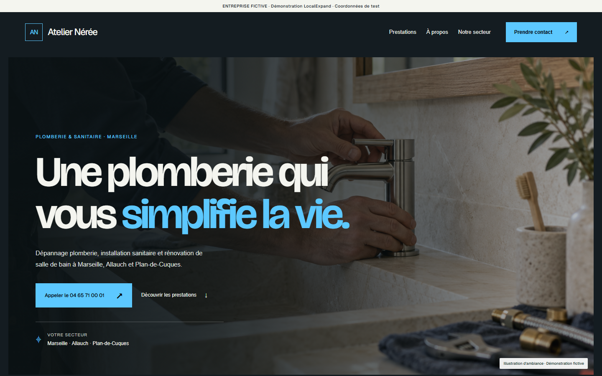
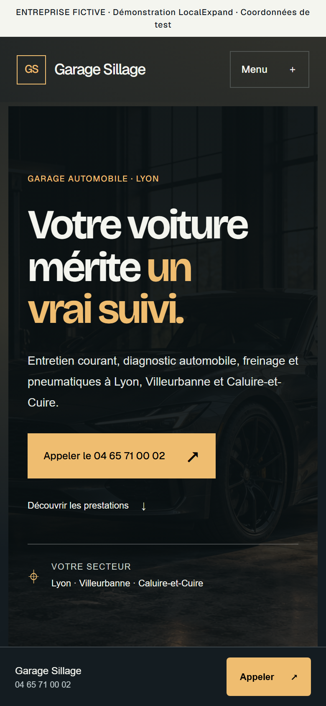
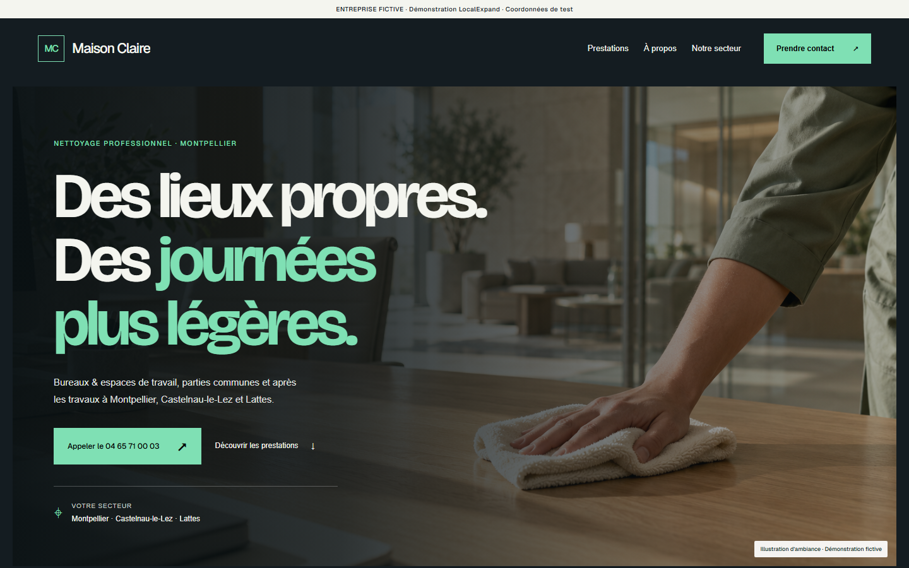
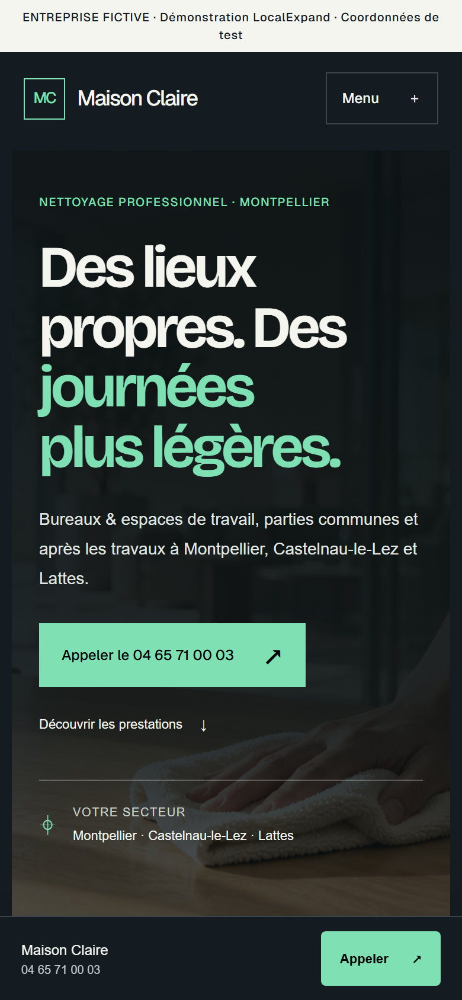

# LocalExpand : générateur de sites vitrines pour entreprises locales

LocalExpand transforme la fiche d'une entreprise locale en site vitrine d'une page. La fiche contient le nom, le métier, les prestations, les zones, les coordonnées et les photos. Le moteur choisit la mise en page, les icônes et les couleurs, puis vérifie le résultat dans un vrai navigateur.

**[Voir les exemples en ligne](https://lesuperf.github.io/localexpand-generateur/)** : trois entreprises fictives, aucun site retouché à la main.

| Ordinateur | Mobile |
| --- | --- |
|  |  |
|  |  |

Ce dépôt présente le **moteur de génération**. L'application complète, privée, ajoute un outil de prospection (API Google Places), un espace professionnel sécurisé et un aperçu en ligne pour les visiteurs.

## Ce que fait le moteur

- **Composition automatique.** Les sections et leurs variantes (en-tête, accroche, prestations, présentation, galerie, avis, zones, FAQ, contact) sont choisies selon les informations disponibles. Une section sans donnée est omise, ainsi que son lien de navigation.
- **Aucun contenu inventé.** Pas de faux avis, de chiffres ni de promesses. L'accroche est composée à partir des prestations et des zones fournies.
- **Rendu soigné sans photo.** Sans photo principale, un visuel est composé aux couleurs de la marque. Chaque prestation reçoit une icône choisie d'après ses mots.
- **Trois styles visuels.** Contraste (par défaut), Clair et Éditorial, avec des couleurs de marque personnalisables. Le contraste du texte (≥ 4,5:1) est garanti, même avec une couleur extrême.
- **Sites autonomes.** Aucun JavaScript, polices et images intégrées, et un ZIP prêt pour un hébergement statique. Le menu mobile et la FAQ fonctionnent en HTML et CSS seuls.

## Qualité et sécurité

- Contrôles structurels à chaque génération : titre unique, ancres, libellés, attributs ARIA, textes alternatifs, métadonnées, données structurées `LocalBusiness`, absence de script et de ressource distante.
- Contrôle navigateur (Playwright, Chromium) à 5 largeurs, de 320 à 1440 px : débordement, images, polices, menu mobile, FAQ au clavier, liens de contact, ouverture hors ligne.
- Politique de sécurité du contenu (CSP) stricte, échappement de tous les textes fournis, images limitées aux formats PNG, JPEG et WebP, validées par leur signature.
- 67 tests automatisés dans ce dépôt (plus de 200 dans l'application complète).

## Essayer

Prérequis : Python 3.10 ou plus récent.

```bash
python -m pip install -r requirements.txt
python -m playwright install chromium      # pour les captures et le contrôle navigateur

python generer_exemples.py                 # génère les trois sites dans docs/
python generer_exemples.py --verifier      # ajoute le contrôle navigateur
python -m unittest discover -s tests -t .  # lance les tests
```

Générer un site depuis du code :

```python
from generation.profile import BusinessProfile
from generation.essential import prepare_essential, render_essential

fiche = BusinessProfile.from_dict({
    "name": "Atelier Exemple", "profession": "Menuiserie", "city": "Lyon",
    "description": "Présentation de l'entreprise.", "phone": "04 65 71 00 00",
    "services": ["Pose de parquet", "Agencement sur mesure"],
})
site = render_essential(prepare_essential(fiche))
print(site.status)        # "generated"
html = site.document      # page complète, prête à exporter
```

## Organisation

| Dossier | Contenu |
| --- | --- |
| `generation/` | Moteur : fiche entreprise, composants, styles, icônes, contrôles qualité, export. |
| `design-assets/` | Polices embarquées (Geist, Instrument Serif, Bricolage Grotesque) et leurs licences SIL OFL. |
| `exemples/` | Illustrations des entreprises fictives et style de la page d’accueil des exemples. |
| `docs/` | Sites d'exemple générés, publiés avec GitHub Pages. |
| `tests/` | Tests automatisés du moteur. |

## Technologies

Python · HTML · CSS · JavaScript (application complète) · Playwright · BeautifulSoup · SQLite et API Google Places (application complète)

## Crédits

Conception et direction du projet : Florian Husaj. Développé avec l'assistance d'outils d'IA (Codex, Claude Code).

Les entreprises, coordonnées et illustrations des exemples sont fictives. Les numéros de téléphone appartiennent à la plage réservée par l'ARCEP aux œuvres de fiction. Les polices sont distribuées sous licence SIL Open Font License 1.1.

© 2026 Florian Husaj. Tous droits réservés. Le code est publié pour consultation ; contactez l'auteur pour toute réutilisation.
